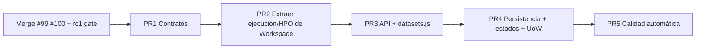

# Plan: Refactor progresivo Clean Architecture

> **Spec:** [spec.md](spec.md) · **ADR:** [010](../../decisions/010-progressive-clean-architecture-refactor.md)  
> **Estado operativo:** [`TASKS.md`](../../../TASKS.md)  
> **Brief para agente implementador PR1:** [agent-brief-pr1.md](agent-brief-pr1.md)

---

## Principio

Refactor **progresivo**, no rewrite. Cada PR debe:

1. Mantener la API pública usable (fachada / CQRS).
2. Añadir o migrar tests de contrato.
3. Dejar el árbol más cerca de la estructura objetivo sin big-bang moves.

**Condición obligatoria:** mismos datasets + semillas + folds → resultados equivalentes, salvo corrección estadística documentada.

---

## Estructura objetivo (referencia)

```
src/automl/
├── domain/
│   ├── datasets/
│   ├── experiments/          # validation.py (ya existe post-audit-3)
│   ├── evaluation/           # metrics.py, policies.py (nuevo / consolidación)
│   ├── recipes/
│   └── runs/
├── application/
│   ├── commands/ / queries/ / registries/   # conservar CQRS
│   ├── services/
│   │   ├── workspace.py      # fachada delgada
│   │   ├── experiment_execution_service.py
│   │   ├── optimization_service.py
│   │   ├── dataset_service.py
│   │   └── … (feature / inference / pipeline ya existen)
│   └── ports/
├── engine/
├── infrastructure/
│   ├── database/             # repos por agregado (PR4)
│   ├── filesystem/
│   └── security/
├── interfaces/web/api/       # controllers (PR3)
└── plugins/
```

---

## Cadena de PRs



### Gate previo (humano / merge)

- Merge **#99** (Sprint 2 UX) y **#100** (audit-3 contracts) en `main`.
- No abrir PR2/PR3 sobre `main` viejo sin esos contratos.

---

## PR 1 — Contratos y reglas compartidas (bajo riesgo)

**Objetivo:** Una sola fuente de verdad para métricas, CV y especificación de ejecución.

| Trabajo | Detalle |
| --- | --- |
| `MetricSpec` + registro | Ampliar `domain/metrics/` (hoy solo `direction.py`); builtins + resolución plugin |
| CV | Usar `domain/experiments/validation.py` en todos los callers restantes |
| `ExecutionSpec` | Dataclass frozen; factory desde run+experiment+recipe; trainer consume |
| Errores de dominio | Fail fast tipado para strategy/metric/transition |
| Tests contrato | Mismo ganador MAE/ROC-AUC en schedule, `get_best_trial`, helper leaderboard |

**No hacer en PR1:** partir `server.py`, partir `datasets.js`, Unit of Work, mover SQLite a multi-repo.

**Dueño sugerido:** agente implementador (ver [agent-brief-pr1.md](agent-brief-pr1.md)).

**Criterio done:** tests nuevos verdes; consumidores críticos ya no usan `max()` ciego ni listas de métricas hardcodeadas duplicadas; cobertura global ≥ 85 %.

### PR1 acceptance checklist

- [x] `MetricSpec` + registro builtin + `resolve_metric_spec` / `InvalidMetric` (`domain/metrics/`)
- [x] `ExecutionSpec` frozen + `build_execution_spec` / `trial_execution_from_spec`
- [x] Consumidores cableados: Workspace (`run_experiment`, `optimize_experiment`, schedule, `get_best_trial`), benchmarks `is_minimizing_metric`, web `_is_metric_minimizing`, trainer helper
- [x] CV desconocido → `InvalidValidationStrategy` (fail closed)
- [x] HPO mantiene semilla de folds fija (`ExecutionSpec.random_seed` = run seed)
- [x] Tests: `tests/test_clean_arch_pr1_contracts.py` (+ suites audit-3 / métrica / HPO)
- [x] Cobertura global ≥ 85 % (suite completa)
- [x] **Fuera de alcance respetado:** no partir `server.py` ni `datasets.js`; no extraer servicios Workspace (PR2)
- [ ] Merge: preferir `#100` → `#101` (docs) → `#102` (PR1 código)

Implementación código: PR **#102** (`refactor/clean-arch-pr1-metric-execution-contracts`).

---

## PR 2 — Extraer ejecución y optimización de `AutoMLWorkspace`

**Objetivo:** Workspace como fachada.

1. Extraer `run_experiment` → `ExperimentExecutionService`.
2. Extraer `optimize_experiment` → `OptimizationService`.
3. Métodos antiguos en Workspace delegan 1:1 (sin cambiar CLI/MCP/Web).
4. Tests de regresión sobre CSV sintético binario + MAE regression smoke.

**No hacer:** reescribir planner/queue en el mismo PR salvo lo mínimo para compilar.

### PR2 acceptance checklist

- [x] `ExperimentExecutionService` con lógica de `run_experiment` (`application/services/experiment_execution_service.py`)
- [x] `OptimizationService` con lógica de `optimize_experiment` (`application/services/optimization_service.py`)
- [x] `AutoMLWorkspace` expone propiedades lazy + métodos thin (firmas públicas intactas)
- [x] Tests: `tests/test_clean_arch_pr2_execution_services.py` (binary smoke, MAE regression, HPO facade, fail-closed optimizer)
- [x] Imports HPO/trainer muertos eliminados de `workspace.py`
- [ ] Merge PR [#109](https://github.com/Jfenic/CATML/pull/109) (cobertura ≥ 85 %, suite completa verde)

---

## PR 3 — Separar API y frontend

**Backend**

- `server.py` = HTTP glue (parse, status, JSON).
- Controllers: `api/datasets.py`, `experiments.py`, `analysis.py`, `jobs.py`.
- Ciclo de vida app ≠ ciclo de vida request (cuidado con caches mutables).

**Frontend**

```
views/datasets/
  datasets_view.js
  dataset_summary.js
  dataset_columns.js
  data_quality_panel.js
  feature_selector.js
  correlations_view.js
  questionnaire.js
  derived_features.js
```

- Preferir `textContent` / nodos DOM para datos de usuario; `escapeHtml` donde quede `innerHTML`.

---

## PR 4 — Persistencia y estados transaccionales

- Repositorios SQLite por responsabilidad; migraciones comunes.
- Máquina de estados explícita para `AutoMLRun` / experiment / job (cancelado ↛ completed por worker tardío).
- Unit of Work en operaciones críticas (crear experiment + trial + result).

---

## PR 5 — Calidad automática

- Ruff + mypy gradual en `domain/` y `application/`.
- ESLint/Prettier para `static/js`.
- Tests de contrato + E2E Workbench smoke.
- Mantener gate pytest coverage ≥ 85 % en CI.
- (Opcional) endurecer `pip-audit` cuando el equipo lo decida.

---

## Qué no cambiar

- CQRS + registries en `application/`.
- Sistema de plugins.
- SQLite como store local por defecto.
- Paridad Python / CLI / MCP / Web vía application layer.
- Brand system Tech Minimalista en UI.

---

## Tracking

Actualizar solo el track **Clean Architecture Refactor** en `TASKS.md` y `.agent/progress.md` al cerrar cada PR.
