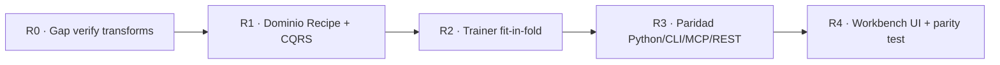

# Plan de Implementación: Experiment Recipes

> **Documento:** Plan por fases (R0–R4)  
> **Estado:** Pendiente de implementación  
> **Especificación:** [spec.md](spec.md) · [ADR-009](../../decisions/009-experiment-recipes-and-interface-parity.md)  
> **Dependencia:** CATML Explore E5–E6 (EvidenceLink, verify) completados  
> **Regla:** Contratos y tests **antes** que UI Workbench

---

## Cadena de fases

---

## Fase R0 — Cerrar el hueco de verificación real (P0)

**Objetivo:** Que `VerifyHypothesisCommand` aplique de verdad las mejoras propuestas, no solo metadata.

### Trabajos
1. Extender `HypothesisExperimentTranslator` + `study_service.verify_hypothesis` para materializar:
   - derivadas sin estado → expresión / feature derivada;
   - transforms con estado → `column_transforms` en el experimento candidato.
2. Distinguir `log1p` vs `yeo_johnson` / `robust_scaler` en `experiment_delta`.
3. Tests: candidato con transform ≠ baseline en features/pipeline; colinealidad drop sigue funcionando.

**Criterio:** Verify de `power_transform` / `robust_scaler` cambia el pipeline real; EvidenceLink sigue siendo Proposed→Verified (accepted/rejected), **sin** auto-promoción.

---

## Fase R1 — Dominio `ExperimentRecipe` + CQRS (P0)

**Objetivo:** Contrato reproducible y estados Selected / Promoted.

### Trabajos
1. Entidades puras en `domain/` (p.ej. `domain/recipes/` o bajo `experiments/`): `ExperimentRecipe`, pasos de transform, status.
2. Persistencia SQLite aditiva (nueva tabla / JSON), migraciones fail-closed.
3. Comandos/consultas:
   - `CreateExperimentRecipeFromEvidenceCommand`
   - `SubmitExperimentFromRecipeCommand`
   - `PromoteExperimentRecipeCommand`
   - `ListVerifiedImprovementsQuery`, `GetExperimentRecipeQuery`, `ListExperimentRecipesQuery`
4. Registro en `application/registries/`.
5. Regla: `EvidenceLink.accepted` ≠ Selected/Promoted.

**Criterio:** Tests de dominio + servicio sin UI; receta round-trip serializable con todos los campos de [spec §6](spec.md).

---

## Fase R2 — Trainer: transforms fit-in-fold (P0)

**Objetivo:** Ciencia limpia para RobustScaler / PowerTransformer.

### Trabajos
1. Extender `SklearnTrainer` / construcción de `ColumnTransformer` para aplicar `column_transforms` **dentro** del `Pipeline` de CV.
2. Test de no-leakage (fit solo en train fold).
3. Compatibilidad con experimentos legacy (sin transforms).

**Criterio:** Suite dedicada + cobertura del motor de training no regresa.

---

## Fase R3 — Paridad Python / CLI / MCP / REST (P0)

**Objetivo:** Agentes y scripts usan el mismo núcleo.

### Trabajos
1. CLI: subcomandos `catml recipe` (o `catml explore recipe`) — `list-verified`, `create-from-evidence`, `submit`, `promote`, `show`.
2. MCP tools + políticas (lectura libre; submit/promote con ledger / aprobación).
3. REST endpoints espejo para Workbench.
4. Documentar en `DEVELOPER_GUIDE.md` y superficie MCP README.

**Criterio:** Un agente puede completar el flujo MCP de la spec sin usar el navegador; mismos IDs de receta en CLI y MCP.

---

## Fase R4 — Workbench + prueba de paridad (P1)

**Objetivo:** UI como cliente, no dueña de la lógica.

### Trabajos
1. Explore: listar mejoras verificadas → “Crear receta” / “Usar en experimento” (Selected).
2. Experimentos: selector de recetas, submit, ver lineage hacia EvidenceLink.
3. Promote explícito tras comparación de leaderboard.
4. **Test de paridad automatizado:** CLI crea → MCP lee → REST/Workbench ve → submit idéntico.

**Criterio:** Ninguna regla de negocio solo en JS; paridad verde en CI.

---

## Fase posterior (no bloquear R0–R4)

- Meta-learning: priors de transforms por fingerprint de dataset (experiencias ≠ garantías).
- Grid A/B/C/D multi-brazo en un comando.
- Unificación con `PipelineGraph` multimodal.

---

## Orden de PRs sugerido

| PR | Fase | Título sugerido |
|----|------|-----------------|
| 1 | R0 | `feat(explore): apply verified transforms in hypothesis verification` |
| 2 | R1 | `feat(recipes): domain ExperimentRecipe and CQRS promote/select` |
| 3 | R2 | `feat(training): fit-in-fold column transforms for recipes` |
| 4 | R3 | `feat(recipes): CLI MCP REST parity for experiment recipes` |
| 5 | R4 | `feat(ui): workbench recipe selection and parity e2e` |

---

## Checklist anti-regresión

- [ ] No bypass de `CommandBus` / `QueryBus` desde interfaces
- [ ] No fit de RobustScaler/Yeo-Johnson sobre dataset completo pre-split
- [ ] Aprendizaje negativo (rejected) se conserva
- [ ] Agente MCP respeta política de aprobación
- [ ] Cobertura global ≥ 85%
